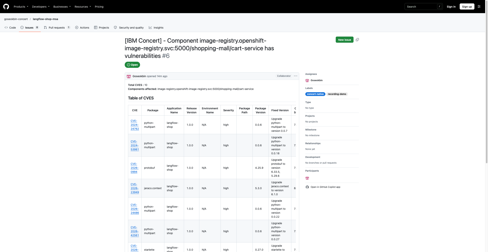
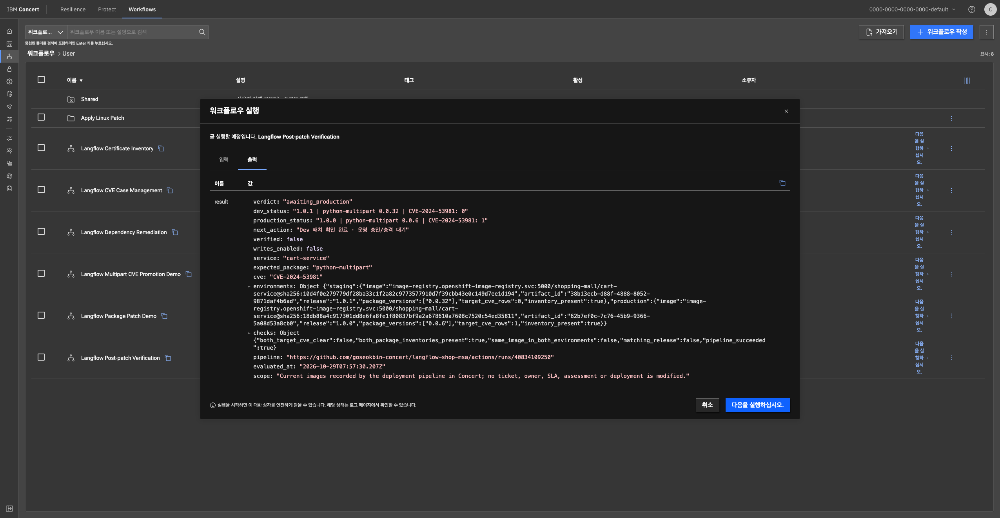
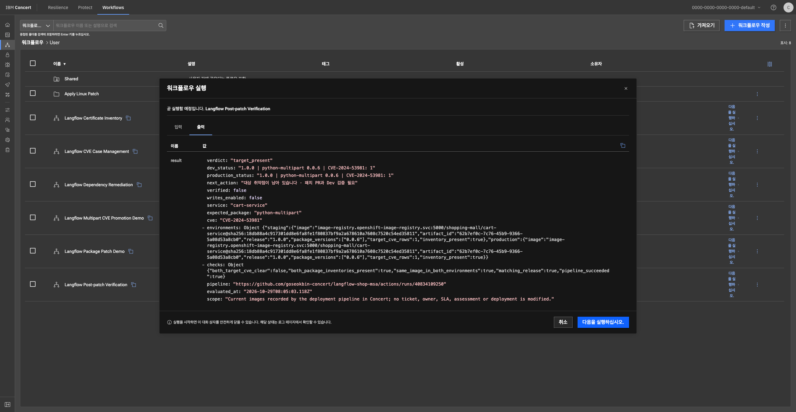

# 촬영 가이드: 운영 CVE 발견 → 1.0.1 패치 → 승인 후 운영 승격

이번 촬영은 **cart-service의 CVE-2024-53981** 한 건을 따라갑니다. 운영 중인 `1.0.0`에서 취약점을 발견하고, 개발자가 `python-multipart==0.0.6`을 `0.0.32`로 수정해 `1.0.1`로 승격합니다. Concert가 위험·담당자·기한·조치 증거를 연결하고, 코드를 변경하는 주체는 개발자입니다.

## 먼저 열어 둘 화면

- [Concert](https://concert-ibm-concert.apps.itz-2cu0mx.infra01-lb.syd05.techzone.ibm.com/concert/) → Protect → Application inventory → langflow-shop → Versions → 1.0.0
- [자동 생성된 cart-service 조치 티켓 #6](https://github.com/goseokbin-concert/langflow-shop-msa/issues/6)
- [앱 저장소](https://github.com/goseokbin-concert/langflow-shop-msa) / [GitHub Actions](https://github.com/goseokbin-concert/langflow-shop-msa/actions/workflows/concert-devsecops.yml)
- [Dev 쇼핑몰](https://frontend-shopping-mall.apps.itz-2cu0mx.infra01-lb.syd05.techzone.ibm.com/) / [운영 쇼핑몰](https://frontend-shopping-mall-prod.apps.itz-64sj1x.infra01-lb.tok04.techzone.ibm.com/)
- Concert Workflows → **Langflow Post-patch Verification**

SSO와 GitHub에 먼저 로그인합니다. 원본 스캔 파일·인증 설정·Secret 화면은 촬영하지 않습니다. Actions의 빌드·스캔 대기 구간은 녹화 중 일시정지하거나 편집으로 줄입니다.

## 촬영 순서와 멘트

| 장면 | 누가 / 어떤 화면에서 | 직접 할 일 | 보여 줄 핵심 |
| --- | --- | --- | --- |
| 1. 운영 위험 발견 | 보안 담당자 / Concert Protect | 1.0.0 → Build artifacts에서 cart-service 선택 → CVE-2024-53981 검색 | 어느 앱·현재 이미지·패키지에 영향이 있는지 연결해서 본다 |
| 2. 담당·기한 확인 | 서비스 담당자 / Automation rules·Goals·GitHub 이슈 | 규칙의 대상 1.0.0, CVSS≥7.5, Fix available, Goseokbin 확인. Goals High 7일·Critical 2일 확인. 이슈 #6 열기 | 기본 Automation rule이 생성·배정했다. Goals가 SLA 준수를 관리한다 |
| 3. 패치 PR | 개발자 / GitHub PR | requirements 한 줄과 release.json을 변경한 PR 작성. 본문에 Refs #6 | 수정 버전과 호환성을 검토하는 책임은 개발자에게 있다 |
| 4. PR 검사 | 개발자·리뷰어 / Patch PR verification | 01 변경 범위, 02 소스·이미지·호환성·health, 03 CodeQL 성공 확인 후 PR 병합 | 패키지가 실제로 0.0.32이고 대상 CVE가 소스·이미지에서 제거돼야 한다 |
| 5. Dev 검증 | GitHub Actions / Langflow shop DevSecOps | main 실행 01–10 완료, 10의 remediation gate와 쇼핑몰 기능 검사 확인 | 패치한 이미지 빌드·재스캔·Concert 수집·Dev 배포를 수행한다 |
| 6. 환경 차이 확인 | 보안·운영 담당자 / Concert Workflows | 아래 기본 입력으로 Run | Dev는 1.0.1·대상 0건, 운영은 1.0.0·대상 존재 → awaiting_production |
| 7. 운영 승인 | 릴리스 승인자 / GitHub | Review deployments → production → Approve and deploy | 운영에 보낼 이미지와 검사 결과를 사람이 확인한다 |
| 8. 운영 승격 | GitHub Actions / 11 운영 배포 | 완료 후 운영 쇼핑몰 기능·이미지 digest 확인 | Dev에서 검사한 동일 이미지 9개를 운영으로 복사하며 재빌드하지 않는다 |
| 9. 최종 확인 | 보안·운영 담당자 / Concert Workflows | 같은 입력으로 다시 Run | 두 환경 1.0.1·동일 이미지·대상 CVE 0건·파이프라인 성공 → verified |
| 10. 조치 기록 | 서비스 담당자 / 이슈 #6 | PR·Actions·검증 결과를 기록 | 이슈에는 다른 CVE도 묶여 있다. 한 건 해결만으로 전체 이슈를 닫지 않는다 |

### 장면 3: 바꾸는 파일은 두 개입니다

`services/cart-service/requirements.txt`:

```diff
-python-multipart==0.0.6
+python-multipart==0.0.32
```

`release.json`:

```json
{"version":"1.0.1","remediation_policy":"multipart-cart"}
```

촬영 전용 브랜치는 **concert-patch/cart-python-multipart-0.0.32**를 사용합니다. 기존 리허설 PR은 병합하지 않은 상태에서 정리합니다. PR 제목은 `fix(cart): patch python-multipart and release 1.0.1`, 본문은 `Refs #6`을 포함합니다. `Closes #6`는 여러 CVE가 묶인 이슈 전체를 너무 일찍 닫으므로 쓰지 않습니다.

### 터미널에서 두 파일을 한 번에 수정하는 방법

`gh auth status`에서 Goseokbin 계정을 확인하고, 저장소의 `main`이 깨끗한 상태에서 실행합니다. push 후 GitHub에서 **Compare & pull request**를 눌러 PR을 만듭니다. PR 생성 화면부터 촬영해도 됩니다.

```bash
git switch main
git pull --ff-only
git switch -c concert-patch/cart-python-multipart-0.0.32
python3 - <<'PYTHON'
from pathlib import Path
import json
p = Path('services/cart-service/requirements.txt')
s = p.read_text()
assert s.count('python-multipart==0.0.6') == 1, '현재 버전을 확인하세요'
p.write_text(s.replace('python-multipart==0.0.6', 'python-multipart==0.0.32'))
Path('release.json').write_text(json.dumps({
    'version': '1.0.1', 'remediation_policy': 'multipart-cart'
}, indent=2) + '\n')
PYTHON
git add services/cart-service/requirements.txt release.json
git commit -m "fix(cart): patch python-multipart and release 1.0.1"
git -c credential.helper= -c 'credential.helper=!gh auth git-credential' push -u origin concert-patch/cart-python-multipart-0.0.32
```

### 장면 6·9: Workflows 입력

| 입력 | 값 |
| --- | --- |
| service | cart-service |
| expected_package | python-multipart |
| cve | CVE-2024-53981 |

시작 상태는 `target_present`, Dev만 패치되면 `awaiting_production`, 양쪽 승격·증거 확인이 끝나면 `verified`가 정상입니다. `verification_incomplete`이면 패키지·이미지·릴리스·전체 파이프라인 성공 여부를 확인하고 완료로 설명하지 않습니다.

## Actions에서 구간별로 보는 방법

PR 검사는 별도 workflow입니다. PR을 병합하면 main의 배포 workflow가 시작됩니다.

1. 01 준비: 커밋과 릴리스를 고정합니다.
2. 02 소스 Trivy / 03 CodeQL / 04 Concert SAST: 의존성 CVE와 코드 정적 검사를 수집합니다.
3. 05 빌드·Push / 06 이미지 Trivy / 07 Concert CVE: 직접 빌드한 7개와 외부 2개 이미지의 결과를 수집합니다.
4. 08 Dev OpenShift / 09 Concert 연결 / 10 기능·패치 게이트: 실제 배포와 현재 이미지의 관계, 쇼핑몰 기능, 선택한 CVE 제거를 확인합니다.
5. 11 운영 승인·승격: 사람이 승인한 뒤 동일 digest를 운영으로 복사하고 재검증합니다.

1.0.1에서 대상 패키지 인벤토리가 없거나 버전이 다르거나 대상 CVE가 남으면 승격 번들을 만들지 않습니다. 전체 CVE 0건을 요구하는 정책은 아니며 다른 CVE는 남아 있습니다. 같은 CVE-2024-53981이 order-service 등 다른 컴포넌트에 남을 수 있으므로, 앱 전체 검색 건수가 아니라 **cart-service의 현재 이미지**를 비교합니다.

## 역할을 설명하는 한 문장

“GitHub Actions가 검사·빌드·배포를 실행하고, Concert Protect가 앱과 운영 위험·담당·기한을 관리하며, Concert Workflows가 두 환경의 조치 완료 증거를 모아 확인합니다.”

Goals는 GitHub 이슈에 Due date를 자동 입력하는 기능이 아닙니다. 현재 기본 GitHub 티켓 수집에는 기존 409 제약이 있어 개별 CVE 행의 티켓 배지와 양방향 자동 종료는 촬영의 성공 조건에 넣지 않습니다. 티켓 실제 생성·담당자 배정은 GitHub #6에서 확인합니다.

## 버전과 촬영 후 관리

- 촬영 시작은 Concert에 **1.0.0 하나**, 패치 시 **1.0.1**이 추가됩니다. 커밋마다 해시가 붙은 앱 버전을 만들지 않습니다.
- 같은 버전은 커밋 하나에 고정됩니다. 이미 생성된 1.0.1에 다른 커밋을 덮어쓰지 않습니다.
- GitHub 브랜치 HEAD, 앱 릴리스 버전, 배포 이미지 digest는 서로 다른 식별자입니다. 촬영에서는 버전 이름을 간단히 보여 주되 증거에는 전체 커밋과 digest를 유지합니다.
- 과거 Concert 버전은 메타데이터·SBOM·발견·배포 문서를 로컬 비공개 백업한 뒤 정리했습니다. 이력 정리는 실행 중인 앱을 바꾸지 않았습니다. 별도 1.0.1 리허설 후 Dev만 미리 보관한 1.0.0 기준 이미지로 복원했고 운영은 승인한 1.0.0을 유지했습니다.
- 실제 AI 모델 응답은 이번 패치 데모 범위에서 제외합니다. 이번 촬영은 쇼핑몰 앱 패치만 다룹니다. VM 패치 데모는 별도 준비 범위입니다.

## 리허설 결과

| 실제 확인 | 결과·증거 |
| --- | --- |
| 1.0.0 전체 파이프라인 | [01–11 성공](https://github.com/goseokbin-concert/langflow-shop-msa/actions/runs/40834109250). 사람이 운영 승인, 동일 이미지 9개 승격·운영 기능 검사 성공 |
| 패치 PR 검사 | [3개 job 성공](https://github.com/goseokbin-concert/langflow-shop-msa/actions/runs/40836719449). 변경 범위·소스/이미지 CVE·의존성·health·CodeQL |
| 1.0.1 Dev 리허설 | [01–09 성공](https://github.com/goseokbin-concert/langflow-shop-msa/actions/runs/40837083211). 실제 0.0.32 배포·수집 |
| 10단계 도구 수정·재검증 | [동일 원본 스캔과 현재 Dev로 성공](https://github.com/goseokbin-concert/langflow-shop-msa/actions/runs/40839301118). 기능 9개·대상 CVE 제거 게이트·승격 번들 생성 통과. 앱 이미지 재빌드 없음 |
| 환경 차이 | Workflows 실제 결과: Dev 1.0.1 / 0.0.32 / 대상 0건, 운영 1.0.0 / 0.0.6 / 1건 → awaiting_production |
| 촬영 시작 상태 복원 | Concert 1.0.0 하나, 두 클러스터 9/9 Ready·동일 이미지 9개·0.0.6, Workflows target_present, 복원 후 Dev 기능 9개 재통과 |

최초 리허설 10단계는 원본 Trivy JSON 대신 Concert 업로드용 CycloneDX를 읽어 실패했습니다. 로더를 수정하고 같은 인증된 원본 스캔·동일 Dev 이미지로 마지막 기능·게이트·승격 번들을 재검증했습니다. 최초 실행 전체가 한 번에 성공했다고 설명하지 않습니다.

리허설 PR #8은 **병합하지 않고 종료**했으며 임시 브랜치·Concert 1.0.1·버전 바인딩을 정리했습니다. 따라서 위 명령으로 새 패치 PR을 만들 수 있습니다. 실제 1.0.1 운영 승격과 마지막 verified 장면은 촬영할 때 직접 승인하여 진행합니다.

[기계 판독용 실제 확인 결과](recording-demo/rehearsal-evidence.json)







CI 연결 토큰은 2026-11-01 16:12 KST까지 유효합니다. 이후 실습에는 토큰을 갱신합니다. 브라우저 SSO는 촬영 전에 로그인합니다.
